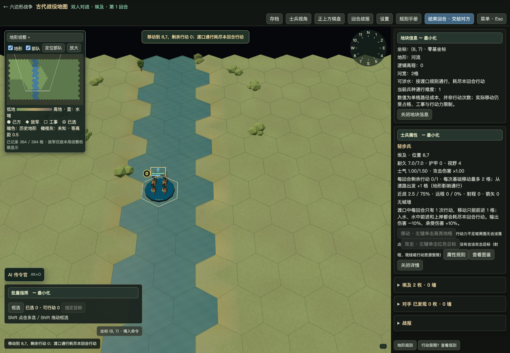
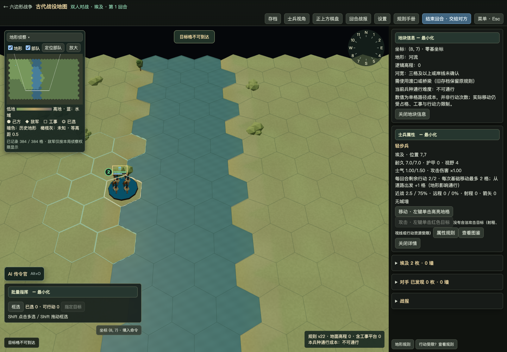

# 窄河涉水 v28.23

2026-11-02。已按用户确认执行：一至两格宽河段可以直接涉水，三格及以上必须使用渡口或桥梁。

## 规则实现

- 陆军进入确认的一格、两格宽河格，使用原有渡口的移动成本、行动耗尽、在水中行动次数及战斗修正。每一步仍为合法六角格邻接，不允许一次跳过两格水面。
- 三格及以上未标记渡口的河格继续阻挡普通陆军。原有桥梁保持道路通行效果；既有宽河人工渡口仍可通行；拆桥继续保留底层渡口。
- 粮车保留原本独立的渡口／河道运输规则，窄河按对应的人工渡口分支处理，而非另外增加一套行动或耗粮判定。普通陆军的入水、水中前进和上岸按原规则耗尽回合行动。
- 骑兵、战车、战象、斥候、攻城器械等可移动陆军均调用统一接口；城墙、敌军占格、士气、行动力及其他原有约束仍需满足。舰船和海域的通行规则没有放宽。
- 河宽从格子及两岸的实际地形计算，不读取模型、海拔或相机。对六边形三组相反轴分别检查连续水格与两端河岸，取可确认的一至两格截面；海域、地图外和未知格不能充当河岸。河湾、分汊以局部截面判定，不以整条河的最大宽度一刀切。
- 不往真实河流写入道路标记，不生成虚假的渡口或桥梁。河道颜色、地图地形、历史数据和胜负条件保持原数据。

## 接口与兼容

`river-crossing.mjs` 提供局部河宽分类与自然渡口判定；引擎移动成本、实际移动、AI距离场、斥候候选路线、重战车限制、部署、编辑器放置、攻击许可均接入统一判定。批量行军、托管和后勤寻路通过原有共享移动接口获得新规则。

新开当前版本对局默认启用 `map.riverCrossing=1`，该标记进入地图和存档。旧存档没有标记时继续沿用原规则，不在读档时静默改变；旧规则版本的新建测试局也保留其旧规则，除非明确开启。地图编辑器启用新规则，可保存和加载自然涉水区域中的合法陆军。

地块详情显示“河宽”“可涉水／需渡口或桥梁”，规则手册会按本局标记显示对应说明。未知岸线不能通过提示或规划提前获知。河流拓扑变动实时重新判断，不使用可能过期的宽度缓存。

## 验证

- 全量回归：1759项，1739通过、20项失败、0跳过。20项为既有地图快照／哈希／高程往返差异，未删除、跳过或计为通过。
- 窄河专项22项全部通过：1/2/3/4/8格宽度、三组六角轴、双方阵营、不同陆军类型、逐回合两格涉水、行动力耗尽、宽河渡口及桥梁、未知岸线／海域、AI与托管寻路、地块信息、旧存档、编辑器撤销重做和地图往返。
- 另对轻步兵、重步兵、骑兵、重战车进行窄河与人工渡口的攻击预览及真实伤害对照，结果相同，见 `combat-equivalence.json`。
- 实际浏览器通过左键选中及点击地块验证：1/2格河可以进入且行动变为0；3/4格河拒绝进入，单位保留原位置和2次行动；真实河格仍为RIVER，未写入ROAD。截图为同一受控地图与同一相机，并非仅测试独立接口。
- 89场战役建立新局及地图验证成功，扫描3551个河格，原战役地图文件未重写。
- 若旧测试原先将单格水面当作绝对障碍，已改为三格宽阻挡场景；旧v10／v21和旧粮车水运回归仍保留旧规则断言。桥梁、渡口的原有测试没有删除。

## 主要修改

- `web3d/ancient/river-crossing.mjs`：确定性、局部且有界的河宽判断。
- `engine.mjs`：新局规则标记、单位通行、AI、部署、编辑、重战车及现有渡口接口整合。
- `save.mjs`、`app.mjs`：旧存档兼容、编辑器规则标记。
- `tile-details.mjs`、`rules-manual.mjs`：河宽与本局规则说明。
- `shallow-rivers.test.mjs` 及相关渡河回归测试：新旧规则验证。
- `tools/shallow-rivers/`、`docs/shallow-rivers/`：真实操作、89图审计、备份与交付记录。

## 运行与限制

这是河流通行规则调整，会使原本依赖窄河屏障的战役出现新的涉水路线，属于本次授权的战术变化；没有修改军力、伤害公式或胜利条件。

对于岸线尚未侦察完整的河段，预览采取保守判断，需继续侦察；真实行动仍交由权威地图验证。编辑器若把已有涉水部队所在区域继续拓宽为深河，需要重新安置该部队后保存，不能依靠编辑功能让其在宽河中合法驻留。

本轮没有声称完成M1帧率测量。河宽判断为每次查询的少量邻格探测，无逐帧全地图重算，没有新增模型、材质或绘制调用。当前89图初始化及河格审计合计约1.57秒（M4 Node单次样本，非单帧或M1指标）。

macOS Apple Silicon程序与完整跨平台源码位于交付目录，签名和网页资源校验见 `package-verification.json`。Windows/Linux需在相应系统构建；真实交互测试使用Chrome WebGL，不冒充原生桌面长期验收。

