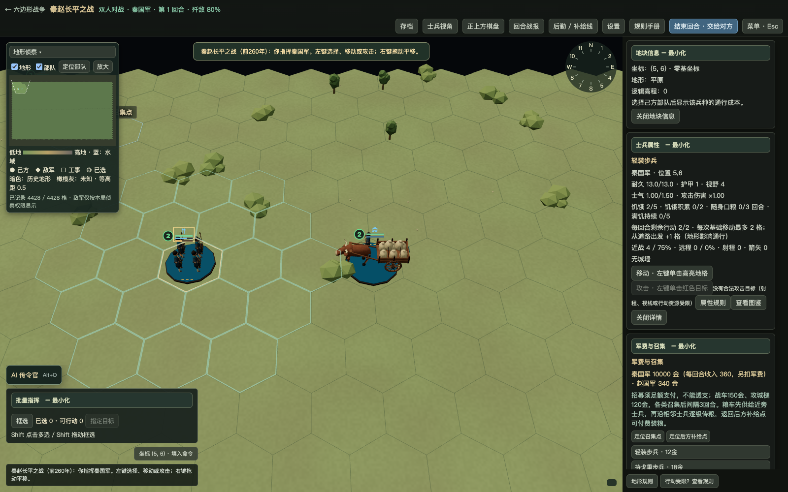
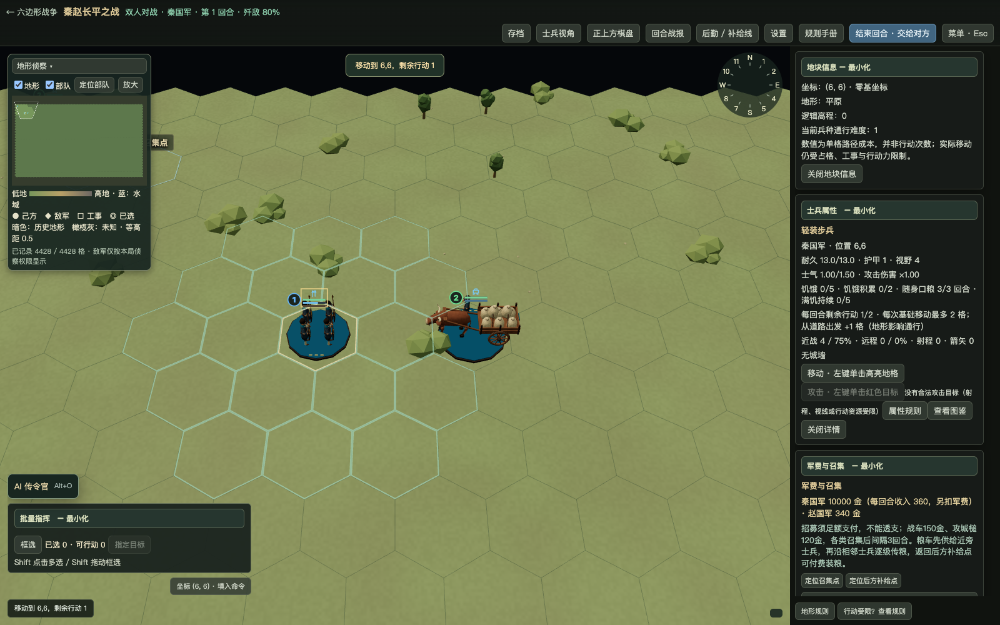
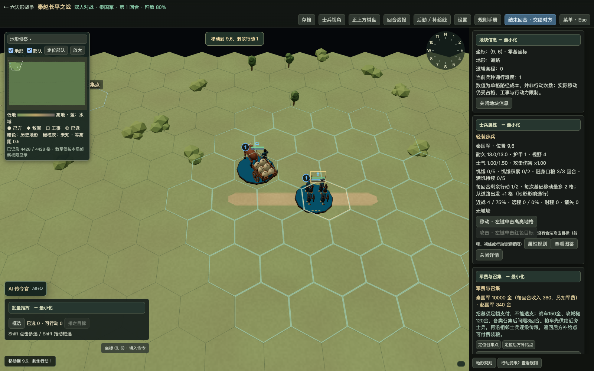
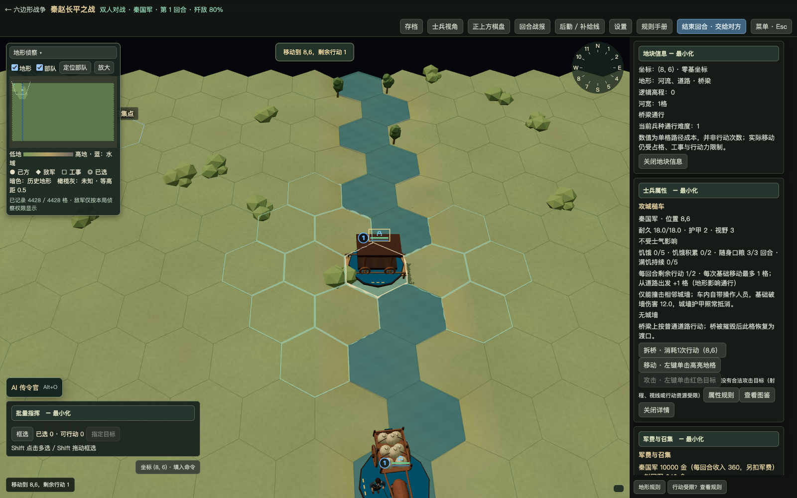

# 接触供粮、饥饿条、道路路权与器械渡河 v28.26

2026-11-02。

## 已完成

1. **接触立即供粮**：士兵移动进入粮车原有两格供粮范围、粮车接近士兵，及行军路径中途接触，都通过共享移动接口即时检查。保留原有相邻士兵传粮；本方回合结束再检查一次。实际扣除车载粮食，优先清除饥饿，再补随身口粮；反复检查不会重复填充已满的口粮。接触检查不推进饥饿时钟，不额外扣除行动力。每回合原有口粮消耗仍只进行一次。
2. **第三条状态条**：长平、秦灭楚、七国之乱、陇西采用原有补给数据，血量、士气下方新增橙色饥饿条，长度为实际饥饿值/5，越长越饿，三级及以上偏红。无饥饿时显示空槽。其他战役不显示、不新增饥饿结算；斥候继续免补给和饥饿。远景按现有密度策略简化，选中单位始终显示完整状态。
3. **道路对向路权**：同阵营道路相遇时，士兵＞前送粮车＞返程粮车。低优先粮车有剩余行动力且存在合法相邻路肩时，实际移动让行并消耗自己的行动力；高优先队伍仍正常付费移动。使用六方向真实路径，不能重叠、瞬移交换或穿越敌军。无路肩、行动力不足、同向、同优先级或被不可撤回委托锁定的粮车不自动让行；可按原规则绕行或等待。共享移动范围、托管路径和运输执行均接入；运输队列先调度前送车辆。不是敌我双方的停战通行协议，也不会替玩家尚未下达的未来指令预留道路。
4. **大型器械不自然涉水**：攻城槌、扭力抛石机、攻城塔、木马（及不可移动防御塔）不享受1—2格窄河自然渡河。移动、预览、AI路线及新部署均要求人工渡口或桥梁；步兵、骑兵、战车和既有粮车运输规则不因此变更。旧存档已经位于水中的器械允许加载及离开，不允许继续进入没有渡口的河格。

## 代码位置

- `engine.mjs`：共享 `checkContactSupply`、逐路径接触、本方回合末检查、付费道路让行及器械移动约束。
- `road-priority.mjs`：明确优先级、对向判断、合法路肩选择。
- `known-route.mjs`：托管与运输规划识别可合法让行的位置。
- `logistics-plan.mjs`：前送优先调度；接触供粮与行程损耗分账，避免把交给士兵的粮食重复计为运输损耗。
- `unit-hud.mjs`：真实饥饿条及HUD碰撞布局扩展。
- `river-crossing.mjs`、`tile-details.mjs`、`rules-manual.mjs`：器械能力限制及规则反馈。
- 新增 `contact-supply.test.mjs`，扩展 `shallow-rivers.test.mjs`；原后勤测试保留。`imperial-campaigns.test.mjs`按新交接时点增加回合末断言，核对下一本方回合消耗一份口粮后的值，而非删除旧补给覆盖。

## 验证

- 相关100项测试全部通过：双向接触、路径中途接触、回合末、重复检查、散粮、斥候、敌我过滤、四大战役HUD、保存恢复、六方向×两行奇偶的道路让行、优先级、无路肩/AP不足/同向/敌军拒绝、托管路线、大型器械1/2格河流及人工渡口和桥梁、既有运输与物资守恒。
- 全量1817项：1797通过、20项既有地图基线差异失败、0跳过。无新增失败；没有修改用户地图以掩盖差异。
- 实际Chrome界面左键操作：士兵靠近后饥饿2→0、口粮0→3，粮车120→115；士兵沿路越过对向粮车，士兵和让行车各扣一次行动且位置不重叠；攻城槌不能进入无标记窄河，桥梁可通行。截图与原始结果见本目录。
- 大场景HUD另见 `browser.json` 的 `largeHud`：记录真实单位数量及45帧HUD绘制耗时。这是浏览器HUD局部CPU耗时，不代表完整GPU帧率或M1性能。

## 交付与限制

重新构建macOS Apple Silicon程序及完整跨平台源码，文件匹配和签名结果见交付校验。Windows/Linux原生安装包未在本机构建。真实交互使用Chrome，未冒充原生WKWebView长期稳定性验证。

让行要求实际可移动空间和行动力；狭窄走廊两侧完全封闭或所有车辆行动已耗尽时仍可能等待，未引入免费挪车。让行引擎返回对应移动记录，现有动画观察器继续跟踪车辆位置变化。

